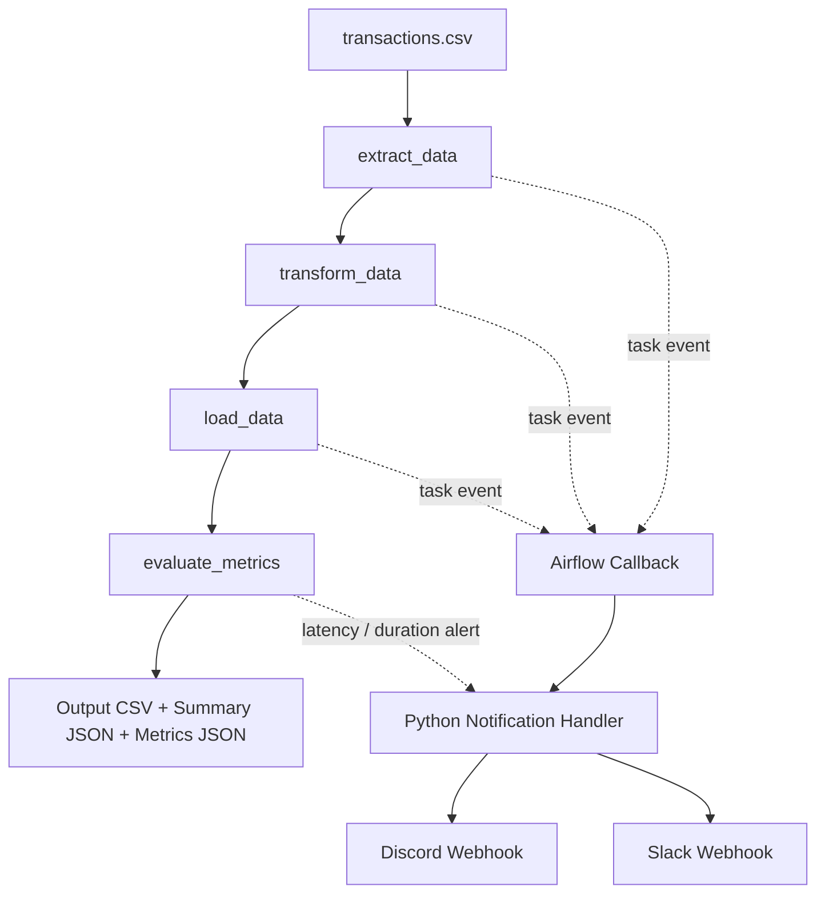
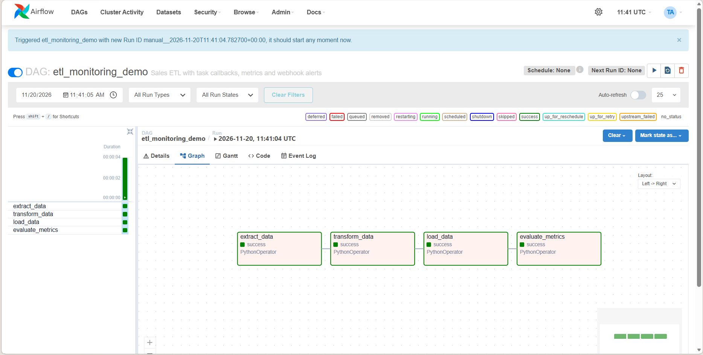
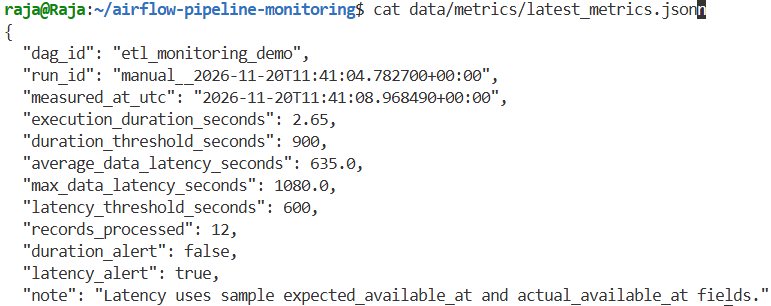
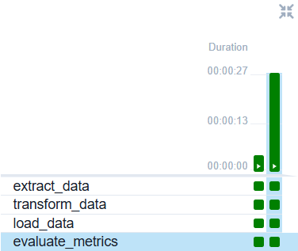
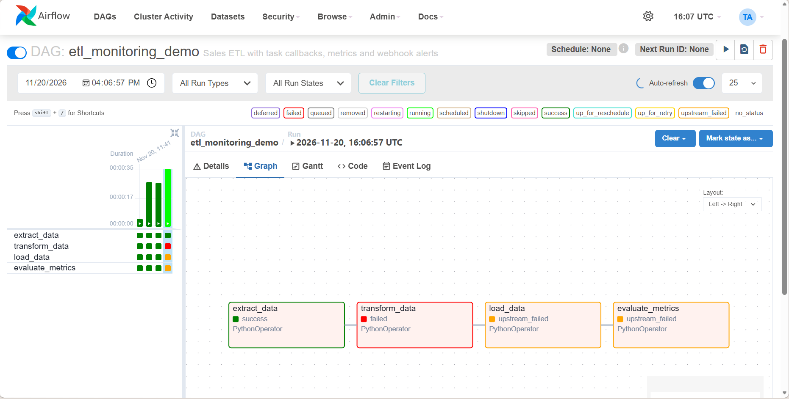
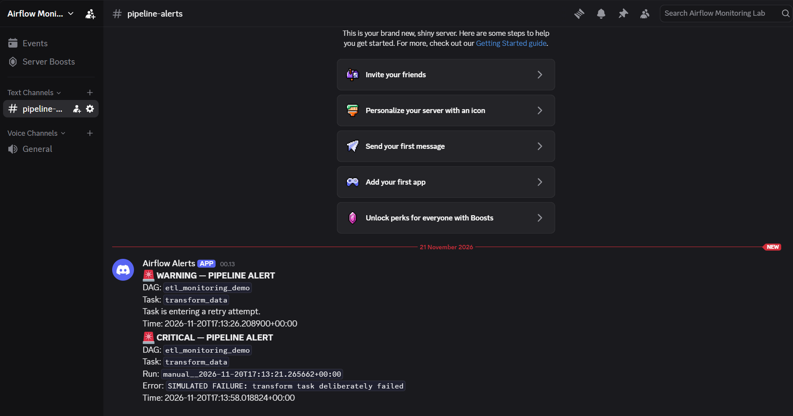

<div align="center">

# Pipeline Monitoring & Alerting
### Pemantauan DAG Apache Airflow dengan Notifikasi Webhook ke Discord dan Slack

[](https://airflow.apache.org/)
[](https://www.docker.com/)
[](https://www.python.org/)
[](https://www.postgresql.org/)
[](https://discord.com/developers/docs/resources/webhook)

<p align="center">
  Pipeline ETL transaksi penjualan yang dilengkapi pengukuran execution duration dan data latency, perhitungan failure rate, serta alert otomatis melalui Python webhook saat task gagal atau data terlambat.
</p>

</div>

---

## Ringkasan Proyek

Pipeline yang berjalan tanpa dipantau hanya diketahui bermasalah ketika pengguna melapor. Proyek ini membangun pipeline ETL sederhana di Apache Airflow, lalu menambahkan lapisan monitoring dan alerting agar tim dapat langsung tahu **task mana yang gagal, berapa lama pipeline berjalan, dan apakah data tersedia tepat waktu**.

Yang dibangun di proyek ini:
- Pipeline ETL empat task untuk data transaksi penjualan (CSV ke hasil olahan).
- Pengukuran **execution duration** dan **data latency** pada setiap run, disimpan sebagai berkas metrik JSON.
- Perhitungan **failure rate** dari riwayat eksekusi.
- **Callback** Airflow (`on_failure_callback` dan `on_retry_callback`) yang memanggil Python webhook.
- Notifikasi otomatis ke **Discord** dan **Slack** dengan severity `WARNING` dan `CRITICAL`.
- Skenario simulasi kegagalan dan pipeline lambat yang bisa diaktifkan dari Airflow UI tanpa mengubah kode.

---

## Arsitektur Workflow



| Task | Fungsi |
|---|---|
| `extract_data` | Membaca CSV dan mencatat waktu mulai pipeline |
| `transform_data` | Validasi data dan menghitung `revenue = quantity × unit_price` |
| `load_data` | Menyimpan ringkasan hasil ETL |
| `evaluate_metrics` | Menghitung duration dan latency, lalu membandingkannya dengan threshold |

---

## Fitur Monitoring & Alerting

1. **Execution Duration**: selisih waktu antara `extract_data` mulai dan `evaluate_metrics` selesai. Threshold bawaan 900 detik (15 menit).
2. **Data Latency**: selisih `actual_available_at` dan `expected_available_at` setiap transaksi. Alert dipicu oleh nilai **maksimum** yang melebihi threshold 600 detik (10 menit).
3. **Failure Rate**: dihitung dari `run_history.csv` dengan rumus `Failed Runs / Total Runs × 100%`.
4. **Retry dan Callback**: `retries=1` dengan jeda 30 detik. `on_retry_callback` mengirim peringatan `WARNING`, sedangkan `on_failure_callback` mengirim `CRITICAL` setelah retry habis.
5. **Webhook Alerting**: pesan berisi severity, DAG ID, task ID, run ID, dan ringkasan error. Kegagalan pengiriman dicatat di log tanpa menghentikan pipeline.
6. **Simulasi dari UI**: Airflow Variables `simulate_failure` dan `simulate_slow_seconds` memicu kegagalan atau penundaan tanpa mengubah kode.

---

## Tangkapan Layar & Bukti Eksekusi

<div align="center">

### Alur DAG dan Eksekusi Normal
DAG `etl_monitoring_demo` dengan empat task berurutan yang seluruhnya berstatus `success`.
<br/><br/>


<br/><br/>

### Metrik Duration dan Latency
Berkas `latest_metrics.json` hasil `evaluate_metrics`: durasi 2,65 detik (di bawah threshold), sedangkan latency maksimum 1.080 detik melampaui threshold 600 detik sehingga `latency_alert` bernilai `true`.
<br/><br/>


<br/><br/>

### Simulasi Pipeline Lambat
Dengan `simulate_slow_seconds = 20`, Gantt view memperlihatkan bar `load_data` jauh lebih panjang dibanding task lain (run duration 20 detik), sehingga bottleneck langsung terlihat. Total durasi pipeline naik dari sekitar 3 detik menjadi sekitar 27 detik.
<br/><br/>


<br/><br/>

### Simulasi Kegagalan Task
Dengan `simulate_failure = true`, `transform_data` gagal setelah satu kali retry. Task di hilirnya (`load_data` dan `evaluate_metrics`) otomatis berstatus `upstream_failed`, sedangkan `extract_data` tetap `success`.
<br/><br/>


<br/><br/>

### Alert Otomatis di Discord
Pesan `WARNING` muncul saat task masuk retry, dilanjutkan pesan `CRITICAL` ketika kegagalan final, lengkap dengan DAG, task, run ID, dan error.
<br/><br/>


</div>

---

## Struktur Repositori

```text
.
├── dags/
│   ├── etl_monitoring_demo.py        # DAG ETL 4 task + perhitungan metrik
│   └── notification_utils.py         # Callback dan pengiriman webhook (Slack/Discord)
├── data/
│   ├── input/
│   │   ├── transactions.csv          # 12 transaksi sintetis
│   │   └── run_history.csv           # 5 run historis untuk failure rate
│   ├── output/                       # Hasil ETL (tidak dilacak Git)
│   └── metrics/                      # latest_metrics.json (tidak dilacak Git)
├── scripts/
│   └── analyze_run_history.py        # Hitung failure rate, rata-rata duration, latency
├── docs/
│   └── screenshots/                  # Bukti eksekusi
├── Dockerfile                        # Airflow 2.10.5 + requests
├── docker-compose.yaml               # Postgres, init, webserver, scheduler
├── requirements.txt
├── .env.example                      # Contoh konfigurasi (tanpa URL asli)
├── .gitignore
└── README.md
```

---

## Panduan Menjalankan

### Prasyarat
- Docker Engine dan Docker Compose (di Windows disarankan Docker Desktop dengan WSL 2).
- Port `8080` harus kosong. Kalau ada Airflow lain yang berjalan, hentikan dulu dengan `docker compose stop`.

### 1. Clone Repositori
```bash
git clone https://github.com/0Raja0-RA/airflow-pipeline-monitoring.git
cd airflow-pipeline-monitoring
```

### 2. Siapkan Folder dan Environment
Folder runtime dibuat lebih dulu agar tidak dibuat otomatis oleh Docker dengan pemilik `root`:
```bash
mkdir -p logs plugins config data/output data/metrics
chmod -R a+rwX logs plugins config data/output data/metrics
cp .env.example .env
```

Isi `.env` awal (URL webhook boleh dikosongkan, notifikasi eksternal akan dilewati):
```dotenv
AIRFLOW_UID=50000
SLACK_WEBHOOK_URL=
DISCORD_WEBHOOK_URL=
```

> `AIRFLOW_UID` dibiarkan `50000` (nilai bawaan image Airflow). Pada Linux/WSL, folder yang di-mount dimiliki user host, sehingga perintah `chmod` di atas diperlukan agar Airflow bisa menulis log dan output.

### 3. Build dan Inisialisasi
```bash
docker compose build
docker compose up airflow-init
```

### 4. Jalankan Layanan
```bash
docker compose up -d
docker compose ps
```

Buka `http://localhost:8080` dengan login `airflow` / `airflow` (khusus lingkungan latihan lokal), lalu aktifkan dan trigger DAG `etl_monitoring_demo`.

### 5. Menghentikan Layanan
```bash
docker compose down              # hentikan dan hapus container
docker compose down --volumes    # sekaligus hapus database latihan
```

---

## Cara Menguji Skenario

### Memeriksa hasil pipeline
```bash
cat data/output/sales_summary.json
cat data/metrics/latest_metrics.json
head data/output/transactions_clean.csv
```

### Menghitung failure rate dari histori
```bash
python3 scripts/analyze_run_history.py
```

### Mensimulasikan kegagalan dan pipeline lambat
Di Airflow UI buka **Admin → Variables**, lalu tambahkan:

| Key | Value | Efek |
|---|---|---|
| `simulate_failure` | `true` | `transform_data` gagal sengaja (retry lalu failed) |
| `simulate_slow_seconds` | `20` | `load_data` menunggu 20 detik |

Kembalikan ke `false` atau hapus variabel setelah pengujian agar pipeline normal kembali.

### Mengaktifkan notifikasi webhook
Isi URL webhook di `.env`, lalu muat ulang container agar variabel terbaca:
```bash
docker compose down
docker compose up -d
```

---

## Hasil Pengukuran

Hasil run normal pada data contoh:

| Metrik | Nilai | Threshold | Alert |
|---|---|---|---|
| Records processed | 12 | - | - |
| Total revenue | Rp7.450.000 | - | - |
| Execution duration | 2,65 detik | 900 detik | Tidak |
| Rata-rata data latency | 635 detik | - | - |
| Maksimum data latency | 1.080 detik | 600 detik | **Ya** |

`latency_alert` bernilai `true` karena data contoh memang sengaja berisi transaksi yang terlambat lebih dari 10 menit. Ini menunjukkan bahwa pipeline bisa berjalan singkat, tetapi data tetap terlambat dibanding waktu yang diharapkan.

Hasil `scripts/analyze_run_history.py` pada lima run historis:

```text
=== HISTORICAL PIPELINE HEALTH ===
Total runs                  : 5
Failed runs                 : 1
Failure rate                : 20.00%
Average successful duration : 497.5 seconds
Average data latency        : 8.8 minutes
Maximum data latency        : 11.0 minutes
```

---

## Catatan Keamanan

- URL webhook adalah **secret**. File `.env` sudah masuk `.gitignore`, dan repositori hanya menyertakan `.env.example` tanpa URL asli.
- Jangan membagikan URL webhook dalam screenshot, issue, atau log. Jika terlanjur bocor, hapus webhook di Slack atau Discord lalu buat yang baru.
- Pesan error dari library `requests` dapat memuat bagian path URL, yang untuk Discord berisi token. Pada pengujian dengan URL palsu `https://example.invalid/webhook` tampak bahwa path ikut tercetak di log. Jadi komentar "tidak pernah mencetak URL" di kode belum sepenuhnya benar, dan log kegagalan pengiriman sebaiknya tidak dibagikan sembarangan.
- Kredensial `airflow` / `airflow` hanya untuk lingkungan lokal.

---

## Catatan Pengerjaan

- Dikerjakan di Ubuntu pada WSL 2 dengan Docker Desktop.
- Port `8080` sempat bentrok dengan proyek Airflow sebelumnya sehingga container lama dihentikan dulu.
- Pada Linux/WSL, container berjalan sebagai UID `50000` sehingga folder `logs/` dan `data/` perlu izin tulis (lihat langkah 2).

---

<div align="center">
  <sub>Praktikum Data Processing Workflow | Politeknik Elektronika Negeri Surabaya (PENS)</sub><br/>
  <sub>© 2026 Raja Rahman Aziiz</sub>
</div>
